# Assignment 6 

**Name:** Khanzada Nyshanbek Adilqyzy  
**Group:** SE-2539

## Task 0. Setup

In this task, I connected the jQuery library to my HTML file using a CDN link. I used the `$(document).ready()` function to make sure that jQuery code runs after the page is loaded. I also printed "jQuery is ready!" in the browser console to check that jQuery works correctly.

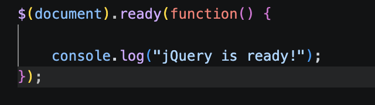

## Task 1. Selectors & CSS

In this task, I created my personal portfolio profile with my name, headline, and a short introduction. I used tag selectors, ID selectors, and class selectors to select HTML elements. I added a Change Greeting button to update the title using `.text()`. I also used `.css()` to change element styles and created Light Theme and Dark Theme buttons to switch the website's appearance.

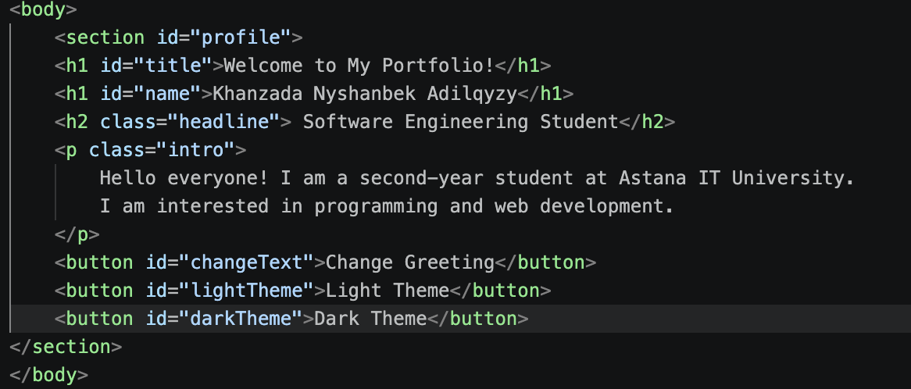

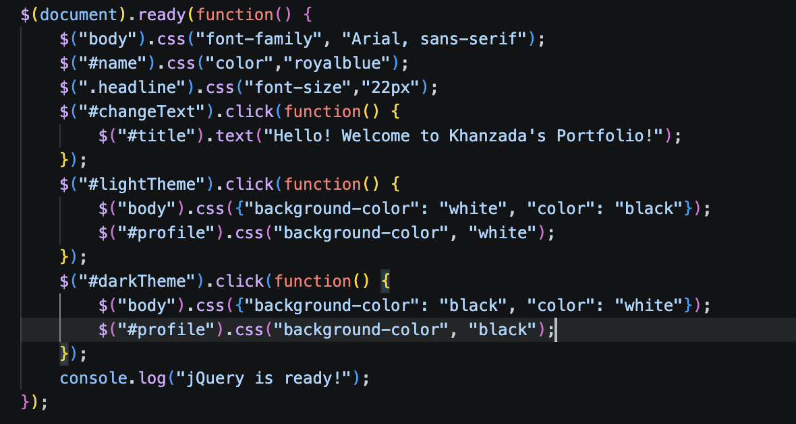

## Task 2. Visibility Methods

In this task, I created an About Me section with my biography, current status, interests, goals, and personal facts. I added three buttons: Hide, Show, and Toggle. I used `.hide()`, `.show()`, and `.toggle()` to control the visibility of the information.

**Screenshots:**

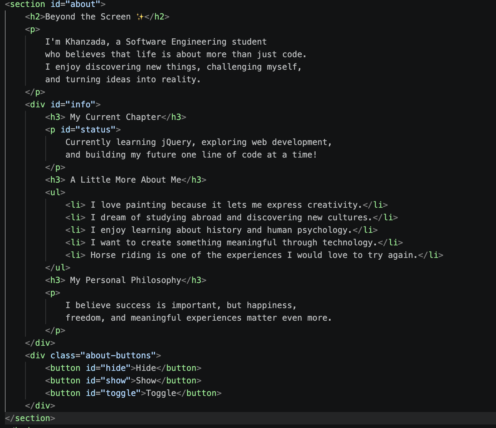

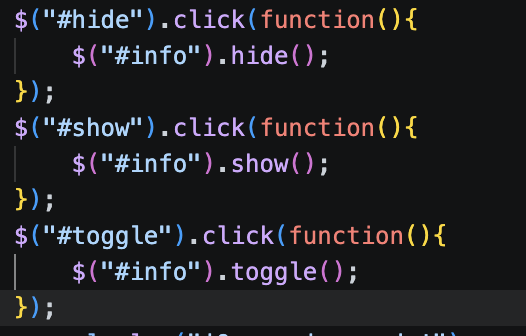

## Task 3. Fade Methods

In this task, I created a gallery with three images related to my creativity and coding journey. I added Fade In, Fade Out, and Fade Toggle buttons. I used `.fadeIn()`, `.fadeOut()`, and `.fadeToggle()` to show and hide the gallery images with smooth effects.

**Screenshots:**

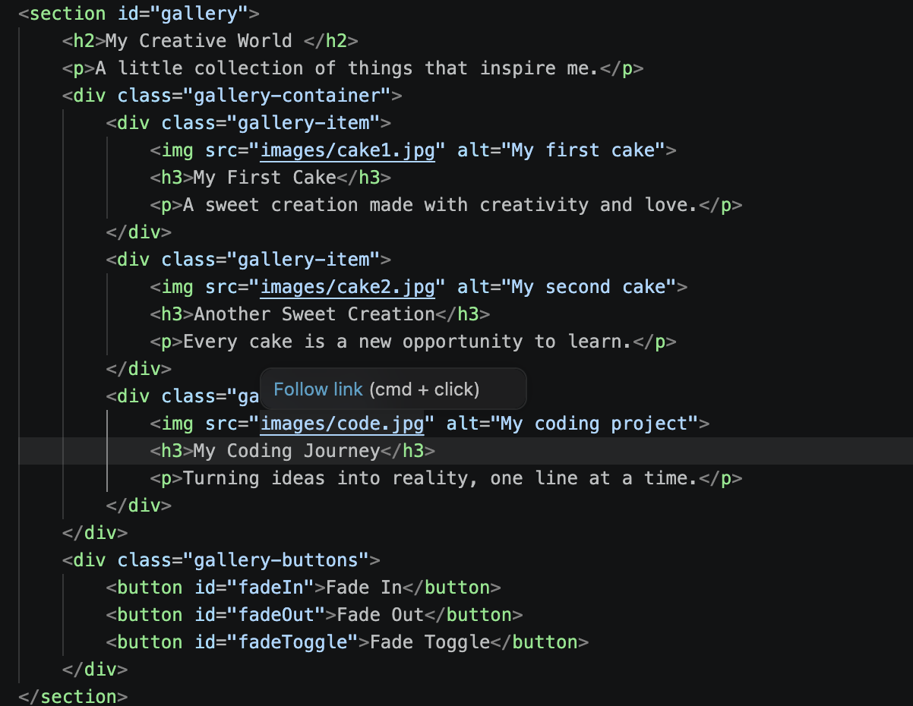

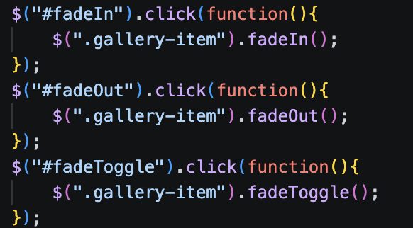

## Task 4. Slide Methods

In this task, I created three clickable headings about my favorite movie genre, favorite subject, and dream destination. Each heading has a content panel with additional information. I used `.slideDown()`, `.slideUp()`, and `.slideToggle()` to open and close the panels with sliding effects.

**Screenshots:**

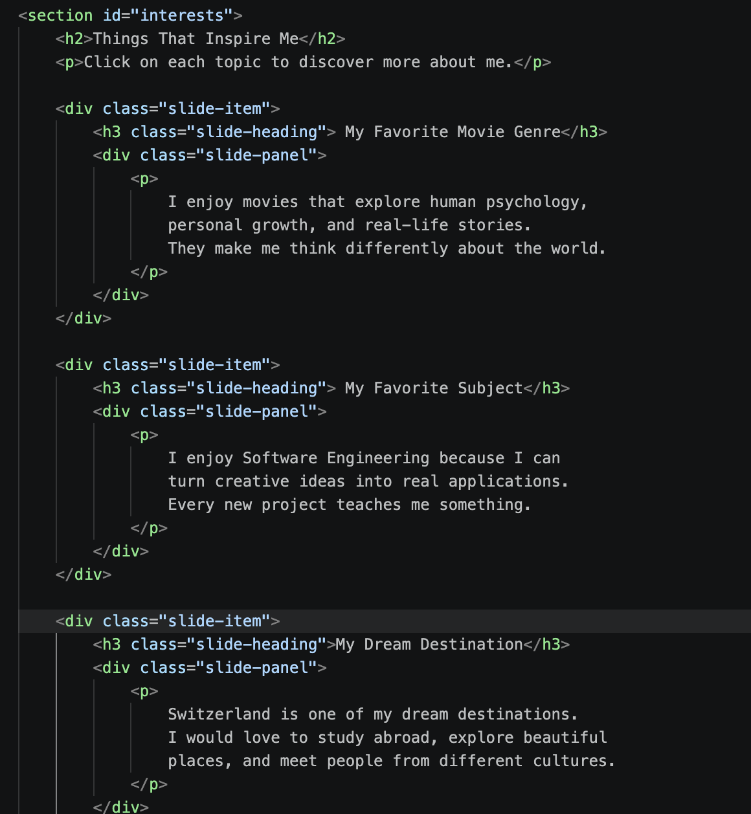

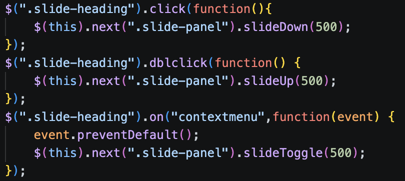

## Task 5. Add & Remove Elements

In this task, I created a technical skills list containing Java, Python, HTML & CSS, JavaScript, and SQL Database. I added an input field where users can enter a new skill. I created Add Skill, Prepend Skill, and Remove Skill buttons. I used `.append()` to add an item at the end, `.prepend()` to add an item at the beginning, and `.remove()` to delete the last item. I also added a condition to prevent empty skills from being added.

**Screenshots:**

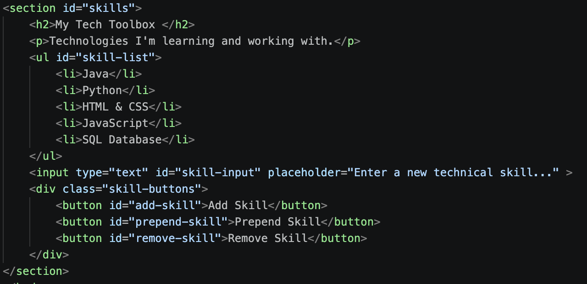

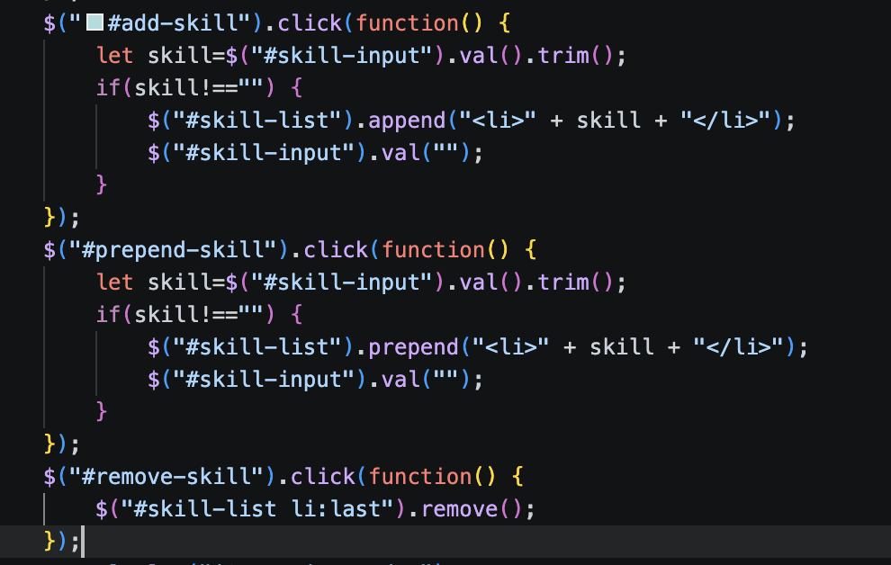

## Task 6. Modifying Attributes

In this task, I added a link to my GitHub profile. I created a button that changes the link destination to my LinkedIn profile. I used the `.attr()` method to change the `href` attribute and `.text()` to update the link text.

**Screenshots:**

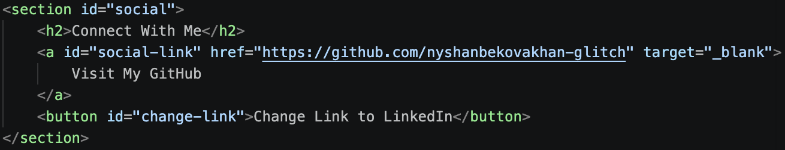

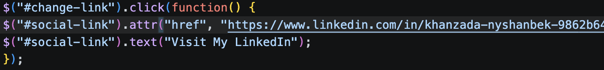

## Task 7. Form Interaction

In this task, I created a contact form with Name and Email input fields. When users type something into the fields, their information appears immediately in the Live Preview section. I used `.val()` to get the input values and `.text()` to display them on the page. I also used the `input` event to update the preview while typing.

**Screenshots:**

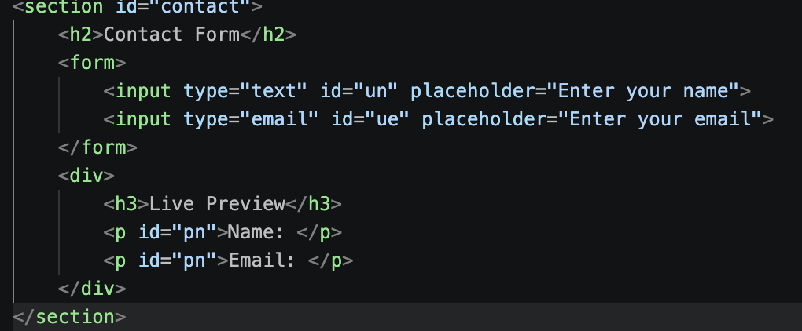

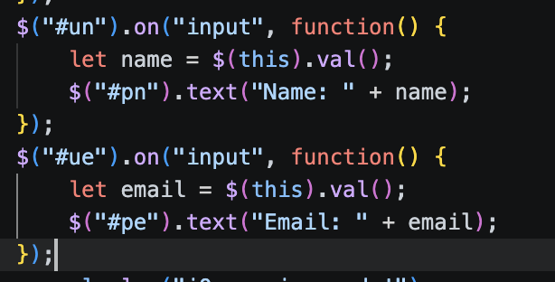

## Task 8. Basic Animation

In this task, I created skill bars for Java, Python, HTML & CSS, and JavaScript. Initially, all skill bars have zero width. I added an Animate My Skills button and used the `.animate()` method to increase the width of each bar to a different percentage. When the button is clicked again, all skill bars return to zero width.

**Screenshots:**

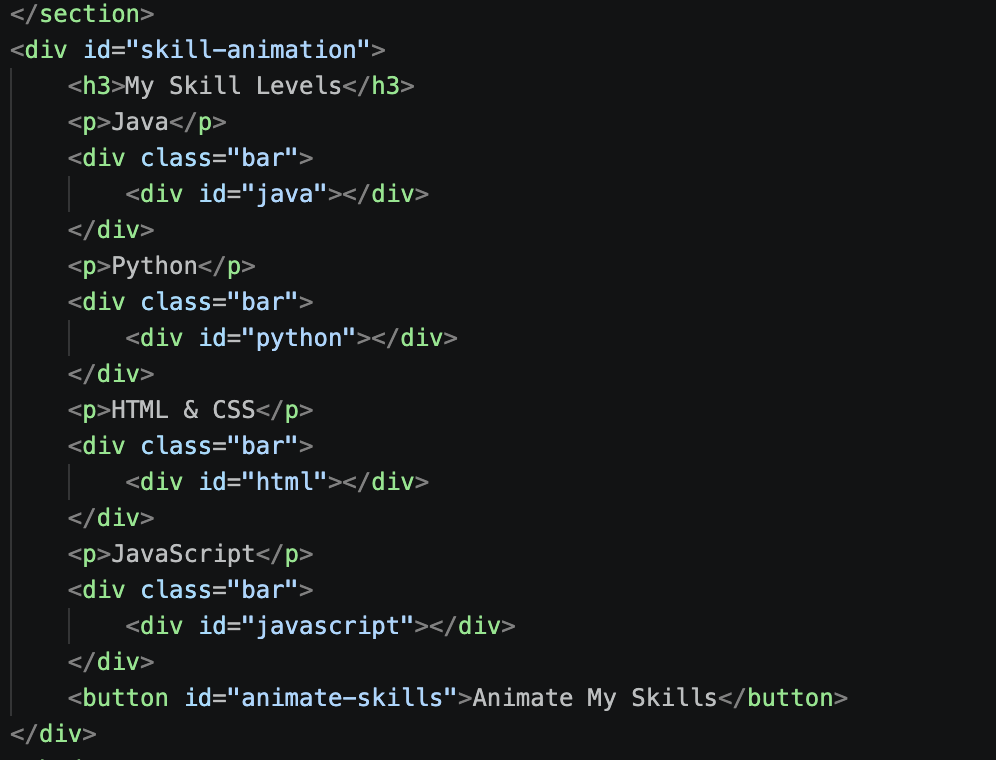

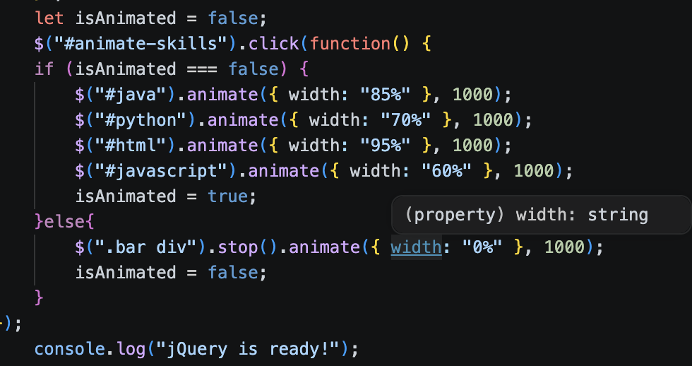

## Conclusion

During this assignment, I learned how to use jQuery to make a website more interactive. I learned how to select HTML elements using different selectors, change text and CSS styles, and handle button clicks and user input. I also practiced visibility methods such as hide, show, and toggle, as well as fade and slide effects. Additionally, I learned how to add and remove HTML elements, modify attributes, and create animations using `.animate()`. This assignment helped me understand how jQuery simplifies JavaScript and makes web development easier.
